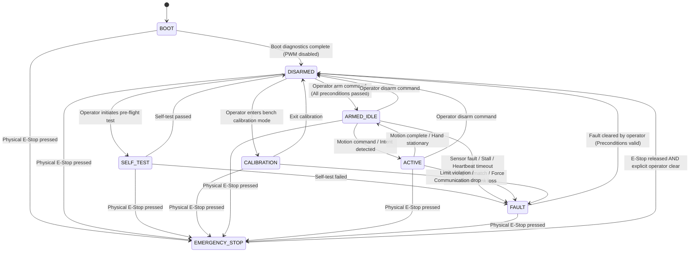

# VAPA Formal Safety Architecture Specification
**Document ID:** VAPA-SPEC-SAFE-001  
**Revision:** 2.0  
**Classification:** Core Engineering Specification  
**Alignment:** ISO 13849-1 (PL d, Cat 3), IEC 60601-1 (Type BF), ISO 13482  

---

## 1. Executive Safety Summary & Principles

The Vision-Assisted Prosthetic Arm (VAPA) is an active upper-limb robotic prosthesis combining multi-modal biological sensing (electromyography, force sensing), computer vision (RGB-D object classification and distance tracking), and multi-channel servo actuation (9 independent degrees of freedom).

Because physical prosthetic devices operate in direct contact with human users and their surrounding environment, **safety is fundamentally architected as a deterministic, fail-closed property of the hardware and firmware**, rather than an optional application software feature.

### Core Non-Negotiables
1. **Safety Defaults Beat Convenience**: The system boots disarmed. It never auto-arms under any circumstance. Arming requires explicit operator command plus 100% satisfaction of all physical pre-conditions.
2. **Never Command Real Hardware Autonomously**: PWM actuation code must always pass through a hardware abstraction layer (HAL) with guarded gating.
3. **Dual-Layer Hardware Cutoff**: Disabling PWM control pulses (`/OE` on PCA9685) does **not** guarantee absence of electrical current or motor torque in the event of an H-bridge short or stalled servo. Actuator safety is enforced by two independent layers:
   - **Layer 1 (Firmware/Logic)**: Independent ESP32 safety supervisor actively forces PCA9685 `/OE` HIGH (quenched by physical 10 kΩ pull-up resistor).
   - **Layer 2 (Hardware Power Isolation)**: Physical normally closed (NC) E-stop loop and PROFET BTS50015 high-side solid-state switch cut primary 6V battery power to all 9 servos within <1 ms.
4. **Biomedical Isolation (IEC 60601-1 Type BF)**: All skin-contact electrodes (MyoWare 2.0 surface EMG) and their analog conversion circuitry are galvanically isolated from the 20A motor battery rail by 1.5 kV DC-DC isolation and bidirectional digital I2C isolators (`ISO1540`).
5. **Shared-Control Principle**:
   - EMG supplies intentional motor control (close, open, hold, mode switch).
   - Vision supplies passive environmental context (preshape aperture, grip profile, force ceiling).
   - **Vision can NEVER initiate or increase a closing motion.**
   - **EMG Open unconditionally overrides all vision recommendations and active grips within ≤ 15 ms.**

---

## 2. Formal 8-State Safety State Machine

The system execution state is governed by a formal 8-state finite state machine (`SafetyStateMachine`) evaluated synchronously on every 10 ms (100 Hz) control cycle on the Jetson and cross-monitored by the ESP32 safety supervisor.



### State Definitions

| State | Allowed PWM? | Servo Power? | Description |
| :--- | :---: | :---: | :--- |
| **`BOOT`** | **NO** | OFF/Gated | Power applied. Microcontroller and Jetson initializing. Hardware pull-ups clamp `/OE` HIGH. Transitions immediately to `DISARMED`. |
| **`DISARMED`** | **NO** | OFF/Gated | Safe quiescent state. Actuation strictly forbidden. Preconditions continuously polled. Hand relaxed. |
| **`SELF_TEST`** | **NO** | OFF/Gated | Automated diagnostic verification: sensor ranges, I2C bus scan, magnet field presence, CRC test vectors. |
| **`CALIBRATION`** | **YES (Guarded)**| ON | Isolated bench calibration wizard. Strictly human-supervised. Slew rate limited to 50% max. |
| **`ARMED_IDLE`** | **YES** | ON | Armed and holding stationary position. High-speed 50 Hz heartbeats active. Ready for movement. |
| **`ACTIVE`** | **YES** | ON | Real-time shared-control grasping and wrist movement active. Full closed-loop monitoring. |
| **`FAULT`** | **NO** | OFF/Gated | Software, sensor, stall, communication, or tracking fault latched. PWM gate immediately clamps all channels to 0.0 µs. Requires operator intervention. |
| **`EMERGENCY_STOP`** | **NO** | **HARD CUT** | Physical NC emergency switch opened or optocoupler circuit triggered. PROFET drops servo rail in <1 ms; `/OE` driven HIGH. Absolute priority. |

---

## 3. State Transition Matrix

| Source State | Target State | Trigger Condition | Guard / Preconditions | Hardware / Software Action |
| :--- | :--- | :--- | :--- | :--- |
| `BOOT` | `DISARMED` | Power-on init finished | None | Drive `/OE` HIGH; initialize data structures; set `arm_request = 0`. |
| `DISARMED` | `SELF_TEST` | Operator command | None | Run I2C bus scan, check AS5600 magnet presence, verify ADC noise floor. |
| `SELF_TEST` | `DISARMED` | Test passed | All checks nominal | Log success certificate; record sensor baselines. |
| `SELF_TEST` | `FAULT` | Test failed | Any sensor abnormal | Latch specific fault reason; refuse arming. |
| `DISARMED` | `CALIBRATION` | Operator command | `initial_state == DISARMED` | Isolate autonomous control loops; enable manual pulse generation. |
| `CALIBRATION` | `DISARMED` | Operator exit | Calibration complete | Save updated YAML config; disable PWM gate. |
| `DISARMED` | `ARMED_IDLE` | Explicit Arm command | **ALL** pre-conditions satisfied: <br>1. ESP link healthy (`rx_age < 500 ms`)<br>2. Physical E-stop released<br>3. Supervisor reports `latched_fault == False`<br>4. PCA9685 I2C responding<br>5. AS5600 magnets detected on all joints<br>6. EMG baseline in [100..800] mV<br>7. FSR baseline < 250 counts | Set `arm_request = 1`; enable 50 Hz heartbeat thread; enable `PWMGate`. |
| `ARMED_IDLE` | `ACTIVE` | Motion intent detected | `arm_request == 1` AND valid EMG intent | Enable trajectory generator; begin slew-rate controlled position updates. |
| `ACTIVE` | `ARMED_IDLE` | Motion completed | Hand reached target or intent dropped | Maintain stationary commanded holding pulse. |
| `ACTIVE` / `ARMED_IDLE` | `DISARMED` | Operator Disarm | None | Set `arm_request = 0`; disable PWM gate; send disarm heartbeat to ESP32. |
| **ANY** | `FAULT` | Sensor/tracking failure | FSR open/short, EMG stuck, encoder stall, loop hang | Set `arm_request = 0`; zero all PCA9685 PWM registers; latch fault. |
| **ANY** | `EMERGENCY_STOP` | Physical E-Stop pressed | E-stop pin goes LOW | ESP32 drives GPIO25 HIGH (<1 ms); PROFET opens; zero PCA9685 pulses. |
| `EMERGENCY_STOP` | `DISARMED` | Operator clear | E-stop physically released AND operator executes `clear_fault()` | Clear latched fault flag; verify preconditions. System remains disarmed. |
| `FAULT` | `DISARMED` | Operator clear | Fault cause resolved AND operator executes `clear_fault()` | Reset fault status; transition to DISARMED. Auto-rearm is strictly prevented. |

---

## 4. Comprehensive Fault Reaction Matrix

The following matrix defines the exact deterministic detection mechanism, detection latency, safe reaction, and recovery criteria for all 14 physical and software failure modes:

| # | Failure Mode | Detection Mechanism | Worst-Case Latency | Immediate Safe Reaction | Recovery Protocol |
| :---: | :--- | :--- | :--- | :--- | :--- |
| **1** | **Physical Emergency Stop** | Hardware NC safety loop via PC817 optocoupler to ESP32 GPIO27. | < 1 ms | Hardware PROFET disconnects 6V servo rail; ESP32 drives GPIO25 `/OE` HIGH; Jetson transitions to `EMERGENCY_STOP`. | Physically twist-release E-stop button; operator must send explicit `clear_fault()` command. |
| **2** | **Heartbeat Timeout** | FreeRTOS task on ESP32 compares `last_heartbeat_time` against `HEARTBEAT_TIMEOUT_MS` (250 ms). | 250 ms | ESP32 supervisor automatically forces GPIO25 `/OE` HIGH, latches `latched_fault = True`, and drops PWM output. | Control loop must resume 50 Hz heartbeats; operator must issue explicit fault clear. |
| **3** | **UART Link Disconnection** | Jetson `esp_link` tracks frame reception age (`rx_age > 500 ms`) and parser CRC errors. | 500 ms | Jetson transitions to `FAULT`; drops `arm_request = 0`; disables PWM gate. | Re-establish physical USB/UART connection; verify baud rate (460,800); run self-test. |
| **4** | **FSR Sensor Disconnection** | `FSRCalibrator` detects raw ADC < 10 counts (open circuit pull-down). | 10 ms (1 cycle) | Immediate transition to `FAULT`; fingers locked in place or opened; actuation disarmed. | Inspect fingertip wiring harness, solder joints, and JST-SH connector; re-run `calibrate_fsr.py`. |
| **5** | **FSR Short Circuit** | `FSRCalibrator` detects raw ADC ≥ 4090 counts (shorted to 3.3V rail). | 10 ms (1 cycle) | Immediate transition to `FAULT`; finger motion halted. | Check sensor lead insulation for pinching against metal chassis; repair short. |
| **6** | **EMG Rail Saturation** | `EnvelopeNormalizer` detects envelope voltage > 3200 mV. | 10 ms (1 cycle) | Arming refused or immediate `FAULT`; closing motion blocked. | Re-attach surface Ag/AgCl electrodes with fresh conductive gel; verify skin impedance. |
| **7** | **EMG Electrode Flatline** | `EnvelopeNormalizer` detects identical ADC value (noise variance = 0) for > 3.0 s. | 3.0 s | System flags sensor detachment fault; disarms active grasp. | Re-apply electrodes to skin; verify battery power on isolated EMG rail. |
| **8** | **Encoder Missing Magnet** | AS5600 `STATUS` register bit 5 (`MD == 0`) polled over TCA9548A I2C mux. | 20 ms | Precondition failure: system refuses to arm; if active, trips to `FAULT`. | Re-align N52 diametric disc magnet to 1.0 mm nominal air gap above AS5600 IC. |
| **9** | **Encoder Weak/Strong Field** | AS5600 `STATUS` bits `ML == 1` (field too weak) or `MH == 1` (field too strong). | 20 ms | Precondition failure; logs magnet alignment diagnostic error. | Adjust axial spacing of magnet using feeler gauges to maintain 30–80 mT field strength. |
| **10**| **Joint Mechanical Stall** | `EncoderMonitor` detects positional error > 12° with measured velocity < 3°/s for > 350 ms. | 350 ms | Immediate transition to `FAULT`; PWM outputs zeroed to prevent servo motor burnout. | Inspect tendon routing, pulleys, and finger pivots for physical obstruction or binding. |
| **11**| **Uncommanded Joint Runaway** | `EncoderMonitor` detects joint velocity > 20°/s while commanded stationary for > 250 ms. | 250 ms | Immediate transition to `FAULT`; servo outputs clamped. | Check tendon cable tension; verify servo horn spline engagement. |
| **12**| **Excessive Grip Force** | FSR measured force exceeds grip profile `force_cap_grams` (e.g. 350g default, 120g cup). | 10 ms (1 cycle) | `FingerForceController` actively backs off servo command by 0.05 units per cycle. | Proportional back-off stabilizes force at ceiling without requiring full disarm. |
| **13**| **Control Loop Thread Hang** | Jetson `HeartbeatThread` monitors loop feed interval (`stall_timeout_s = 50 ms`). | 50 ms | Dedicated thread halts heartbeat transmission and emits `arm_request = 0`. ESP32 trips in 250 ms. | Inspect Linux thread scheduling, CPU affinity, and GPU pipeline bottlenecks. |
| **14**| **FreeRTOS Task Hang** | ESP32 Task Watchdog Timer (TWDT) configured with 350 ms hardware timeout. | 350 ms | Hardware watchdog triggers chip reset. Hardware pull-up holds `/OE` HIGH during reboot. | Firmware automatically recovers to fail-safe `BOOT` -> `DISARMED` state. |

---

## 5. Dual-Layer Actuator Invalidation Architecture

Standard hobby and industrial PWM servo controllers (including PCA9685) can fail in conductive states if the output driver FET shorts or if firmware becomes unresponsive while driving a pulse. To provide **SIL 2 / PL d** safety integrity, VAPA implements dual, fully redundant isolation:

```
                                  [ PHYSICAL E-STOP BUTTON ]
                                              |
                   +--------------------------+--------------------------+
                   |                                                     |
                   v (Normally Closed 24V/12V loop)                      v (Optocoupler Input)
        [ PROFET BTS50015 HIGH-SIDE SWITCH ]                   [ ESP32 SAFETY SUPERVISOR ]
                   |                                                     |
                   v                                                     v (GPIO25 Active-Low OE)
     [ 6V SERVO POWER RAILS A & B ]                               [ PCA9685 PWM DRIVER ]
                   |                                                     |
                   +-------------------------> [ 9x SERVOS ] <-----------+
                                              (V+ Power)    (PWM Signals)
```

1. **Layer 1: Logic Control (`/OE` Gate)**:
   - ESP32 GPIO25 is connected to PCA9685 `/OE` (Pin 23).
   - An external **10 kΩ pull-up resistor to 3.3V** ensures that if the ESP32 is powered off, in reset, flashing, or tri-stated, `/OE` is physically held HIGH, completely disabling all PWM outputs.
   - The Jetson has no electrical connection to `/OE`. It cannot override the ESP32 supervisor.

2. **Layer 2: Power Disconnection (PROFET Switch)**:
   - The primary battery power feeding both 6V buck regulators passes through an automotive-grade Infineon PROFET BTS50015 high-side power switch.
   - The PROFET gate is held enabled only while the hardware Emergency Stop circuit is closed.
   - Striking the physical E-stop switch opens the circuit, causing the PROFET to disconnect battery power to the servo buck converters within **< 1 ms**, completely removing electrical energy from the actuators.

---

## 6. Shared-Control Invariants & Latency Budget

### Safety Invariants
1. **EMG Intent Supremacy**: The human user's muscular intent (EMG) is the primary command. Computer vision provides context (shaping the hand to match an object geometry), but **vision alone can NEVER close the hand**.
2. **Deterministic Open Override**: If an extensor contraction is detected (`EMGIntent.OPEN`), any active closing trajectory, grasp hold, or vision preshape is aborted immediately.
3. **Worst-Case Open Latency Budget**:
   - EMG sampling (ADS1115 @ 860 SPS): **1.2 ms**
   - ESP32 packet encoding & UART transfer (460,800 baud, 32 bytes): **0.7 ms**
   - Jetson envelope normalization & thresholding: **0.1 ms**
   - Arbitrator override evaluation: **0.05 ms**
   - PWM Gate command transmission to PCA9685 (I2C 400 kHz): **0.4 ms**
   - **Total Software Latency: < 2.5 ms** (Well within the 15 ms biological reflex requirement).

---

## 7. Precondition Validation Checklist for Arming

Before transitioning from `DISARMED` to `ARMED_IDLE`, the system performs an exhaustive, synchronous check of all hardware and biological subsystems via `PreconditionValidator`:

- [ ] **Physical E-Stop Released**: ESP32 GPIO27 reads HIGH (normally closed circuit intact).
- [ ] **No Latched Supervisor Fault**: ESP32 supervisor status byte confirms `latched_fault == 0`.
- [ ] **Bidirectional UART Link Synchronized**: Valid CRC-verified sensor telemetry received within the last 100 ms (`rx_age < 100 ms`).
- [ ] **PCA9685 Responding**: I2C `0x40` responds to `MODE1` interrogation with `ALLCALL` disabled.
- [ ] **TCA9548A Multiplexer Responding**: I2C `0x71` responds and passes channel selection test.
- [ ] **Magnetic Encoders Operational**: All configured AS5600 sensors report `MD == 1`, `ML == 0`, `MH == 0`.
- [ ] **FSR Sensor Baselines Plausible**: All 5 fingertips report resting ADC between 20 and 200 counts (no open or short circuits).
- [ ] **EMG Baselines Plausible**: Both flexor and extensor channels report baseline envelope between 100 mV and 800 mV (electrodes making valid conductive skin contact).
- [ ] **Calibration Loaded**: Valid `servos.yaml`, `fsr.yaml`, and `emg.yaml` configurations loaded with calibrated pulse limits.

If any check fails, arming is **strictly refused**, a diagnostic error is logged, and the system remains in `DISARMED`.
